# Relatório de cálculos: Hotéis de Port Alder

Gerado automaticamente por `analise/analise_hoteis.py`. Dataset sintético *Nice Rooms* (CC BY 4.0).

## 1. Carga e inspeção das 7 tabelas

Função usada: `pd.read_json(arquivo, lines=True)`, porque cada linha do arquivo é um registro.
A função própria `inspecionar_tabela()` foi aplicada às 7 tabelas:

| tabela | linhas | colunas | granularidade | ausentes |
|---|---|---|---|---|
| hotels | 14 | 17 | 1 hotel | nenhum |
| room_types | 42 | 10 | 1 tipo de quarto de 1 hotel | nenhum |
| daily_market | 10192 | 58 | 1 hotel em 1 noite | demand_event (9534) |
| weekly_performance | 1456 | 41 | 1 hotel em 1 semana (segunda a domingo) | demand_event (1246); flow_through (728); mean_rating (27); positive_share (27); sentiment_index (27); response_rate (27) |
| rate_decisions | 1442 | 24 | 1 decisão de preço semanal de 1 hotel + resultado da semana seguinte | demand_event (1246) |
| reviews | 12077 | 27 | 1 avaliação de hóspede | response_text (3769); response_hours (3769) |
| review_scenarios | 11 | 7 | 1 cenário (motivo) de avaliação | nenhum |

**Por que os ausentes existem (README do dataset):**

- `flow_through`: não existe no 1º ano (precisa do mesmo período do ano anterior)
- `mean_rating`: semana sem nenhuma avaliação
- `positive_share`: semana sem nenhuma avaliação
- `sentiment_index`: semana sem nenhuma avaliação
- `response_rate`: semana sem nenhuma avaliação
- `response_hours`: o hotel não respondeu à avaliação
- `response_text`: o hotel não respondeu à avaliação
- `demand_event`: noite/semana sem evento (texto vazio)

Decisão: **nenhum valor foi apagado nem preenchido**. Os ausentes têm significado; as funções do pandas (`mean`, `corr`) já ignoram `NaN` nos cálculos.

### 1.1 Coluna com lista dentro do campo: `amenities`

`hotels.amenities` guarda uma lista. Com `df.explode('amenities')` cada item vira uma linha, e aí dá para contar com `value_counts()`.

Hotéis com restaurante (qualquer item com 'restaurant'): **5 de 14**.

| comodidade | hoteis |
|---|---|
| parking | 6 |
| restaurant | 4 |
| gym | 4 |
| breakfast | 4 |
| design rooms | 3 |
| spa | 3 |
| pool | 3 |
| pet friendly | 2 |
| laundry | 2 |
| free parking | 2 |


## 2. Relações entre as tabelas: onde elas se juntam

| pai | filha | chave | chave_unica_no_pai | cardinalidade | max_filhos_por_pai | registros_orfaos |
|---|---|---|---|---|---|---|
| hotels | room_types | hotel_id | True | 1:N | 3 | 0 |
| hotels | daily_market | hotel_id | True | 1:N | 728 | 0 |
| hotels | weekly_performance | hotel_id | True | 1:N | 104 | 0 |
| hotels | rate_decisions | hotel_id | True | 1:N | 103 | 0 |
| hotels | reviews | hotel_id | True | 1:N | 1733 | 0 |
| review_scenarios | reviews | scenario_id | True | 1:N | 1840 | 0 |
| weekly_performance | reviews | hotel_id + week_start | True | 1:N | 27 | 0 |
| weekly_performance | rate_decisions | hotel_id + week_start | True | 1:1 | 1 | 0 |

Integridade: **0 registros órfãos** (nenhum registro aponta para hotel, cenário ou semana inexistente).

Como foi verificado: para cada relação, `filha[chave].isin(pai[chave])` conta quem não tem pai; `value_counts().max()` mostra quantos filhos um pai chega a ter (cardinalidade).

**Redundâncias (normalização):** `hotel_name`, `tier` e `comp_set` se repetem em `daily_market` e `weekly_performance`, e `tier` em `room_types`. São cópias de `hotels`. No banco MySQL elas foram removidas das tabelas filhas (3ª forma normal) e voltam por JOIN.

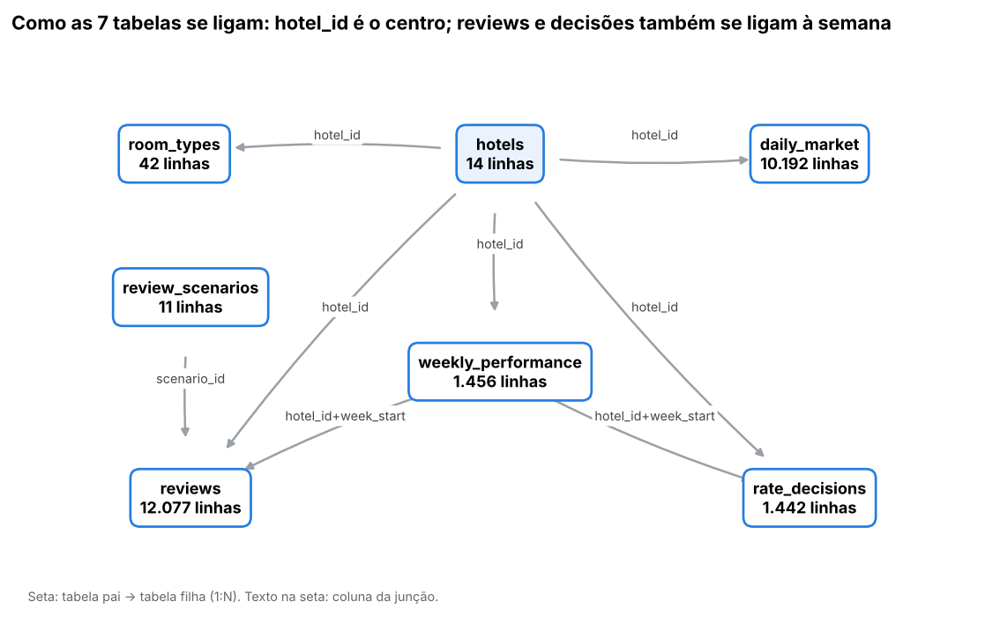
*Mapa de relações entre as tabelas* (arquivo `graficos/G01_relacoes_tabelas.png`)


## 3. Relações entre as variáveis (correlação de Pearson)

Cálculo: `df.corr()` (Pearson) = cov(X, Y) / (desvio(X) × desvio(Y)). Vai de -1 (andam em sentidos opostos) a +1 (andam juntas); 0 = sem relação linear.

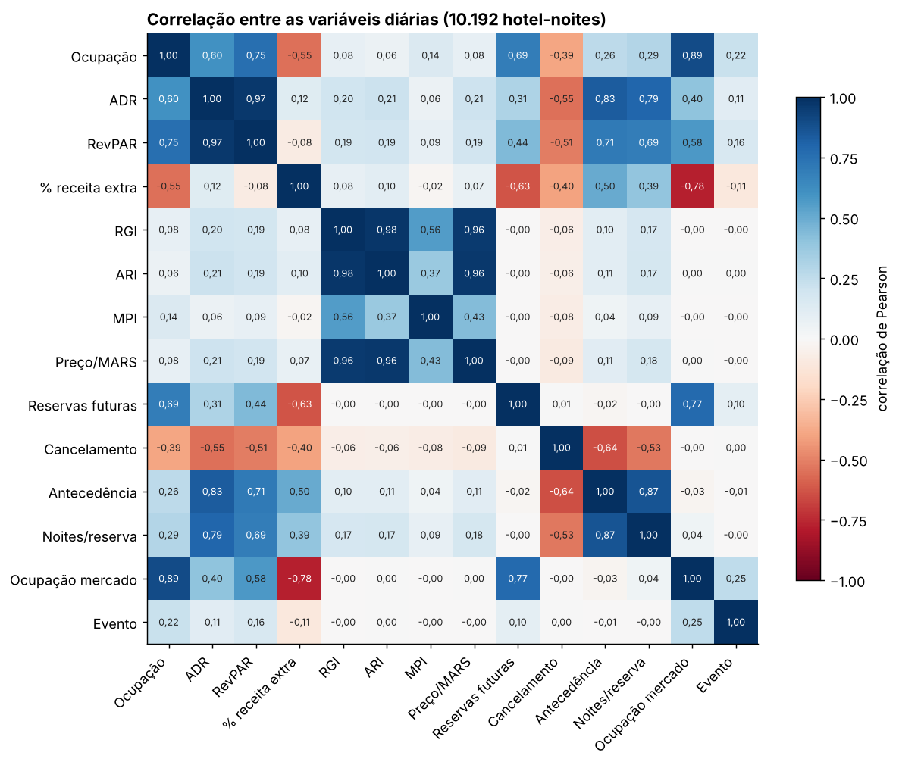
*Matriz de correlação das variáveis diárias* (arquivo `graficos/G02_matriz_correlacao.png`)

**As 10 relações mais fortes:**

| variavel_1 | variavel_2 | r |
|---|---|---|
| RGI | ARI | 0,98 |
| ADR | RevPAR | 0,97 |
| ARI | Preço/MARS | 0,96 |
| RGI | Preço/MARS | 0,96 |
| Ocupação | Ocupação mercado | 0,89 |
| Antecedência | Noites/reserva | 0,87 |
| ADR | Antecedência | 0,83 |
| ADR | Noites/reserva | 0,79 |
| % receita extra | Ocupação mercado | -0,78 |
| Reservas futuras | Ocupação mercado | 0,77 |


### 3.1 Ocupação × diária: mercado inteiro e dentro de cada tier

| grupo | r_ocupacao_adr |
|---|---|
| Mercado inteiro | 0,60 |
| luxury | 0,95 |
| upscale | 0,95 |
| boutique | 0,72 |
| midscale | 0,96 |
| economy | 0,97 |

Misturando todos os hotéis, a correlação fica fraca porque cada tier tem um nível de preço diferente. Dentro de cada tier ela é forte e positiva: noites cheias são as noites caras (alta demanda empurra os dois). É o alerta do enunciado: não misture tiers.

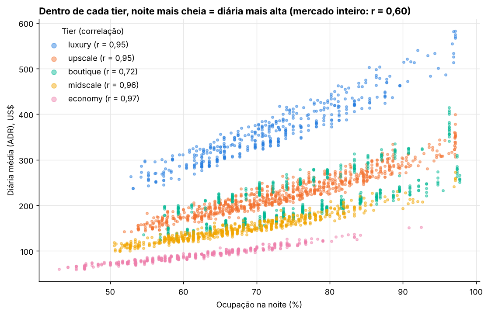
*Ocupação × ADR por tier (amostra de 3.000 noites)* (arquivo `graficos/G03_ocupacao_x_adr.png`)


### 3.2 Nota dos hóspedes × resultado financeiro (semanal)

| variavel | r_com_nota_media |
|---|---|
| revpar | 0,22 |
| rgi | 0,02 |
| occupancy | 0,09 |
| adr | 0,25 |

Por hotel (nota de toda a vida × RGI médio, 14 pontos): r = 0.10.

Semana a semana a nota quase não acompanha o dinheiro. Correlação não é causa: mesmo quando aparece alguma relação, a nota e a receita podem ter uma causa comum (tier, estação). Com 14 hotéis, um r por hotel é instável (amostra pequena).

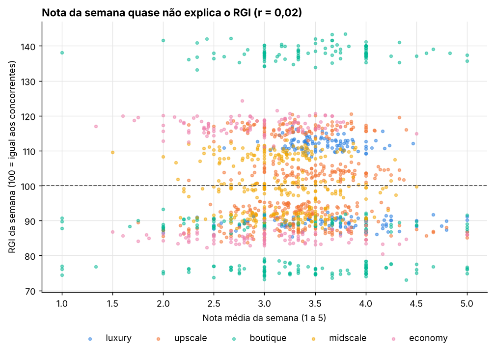
*Nota média semanal × RGI semanal* (arquivo `graficos/G04_nota_x_rgi.png`)


### 3.3 Quais notas parciais andam junto com a nota geral

| nota_parcial | r_com_nota_geral |
|---|---|
| Localização | 0,17 |
| Custo-benefício | 0,81 |
| Sono | 0,87 |
| Serviço | 0,88 |
| Conforto | 0,88 |
| Limpeza | 0,90 |

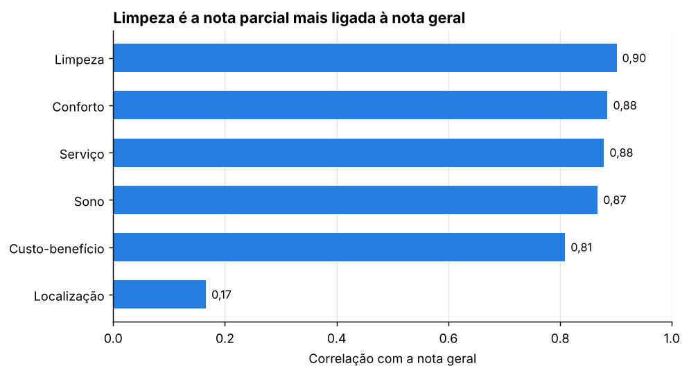
*Correlação das notas parciais com a nota geral* (arquivo `graficos/G05_notas_parciais.png`)


## 4. Diária mais adequada de cada hotel (MARS)

MARS (*market appropriate rate*) é a diária que o hotel **deveria** cobrar naquela noite, dado o que os concorrentes diretos (mesmo tier) estão conseguindo cobrar e o quanto o hotel é melhor ou pior que eles (`positioning_index`).

```
MARS(h, d) = mediana(ADR dos concorrentes de h na noite d)
             × posicionamento(h) / mediana(posicionamento dos concorrentes)
```

**Exemplo passo a passo: Marisol Bay Resort (H03), noite 2028-08-12, grupo `luxury`**

| Concorrente | ADR na noite | Posicionamento |
|---|---|---|
| The Copper Meridian | US$ 563,47 | 1,15 |

1. Mediana do ADR dos concorrentes = US$ 563,47
2. Posicionamento do hotel = 1,22; mediana dos concorrentes = 1,15
3. MARS = 563,47 × 1,22 / 1,15 = **US$ 597,77**
4. Faixa aceitável (±6%): US$ 561,90 a US$ 633,63
5. Diária cobrada (ADR) = US$ 634,87 → posição = ADR / MARS = 1,062 (6,2% em relação ao MARS)
6. Valor no dataset (`mars_rate`) = US$ 597,77 ✔

**Recalculando o MARS das 10.192 noites e comparando com o dataset:**

- Erro médio: 0.00146% · erro máximo: 0.0075% (só arredondamento). **A fórmula foi reproduzida.**

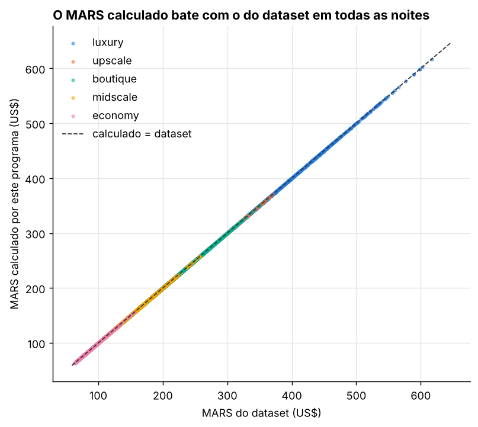
*Validação do cálculo do MARS* (arquivo `graficos/G06_validacao_mars.png`)


### 4.1 Diária adequada × diária cobrada, por hotel

Para cada hotel: ADR cobrado = soma(receita de quartos) / soma(quartos vendidos); MARS médio = soma(MARS × quartos vendidos) / soma(quartos vendidos), ponderado igual ao ADR para comparar maçã com maçã.

| hotel_name | tier | adr_cobrado | mars_adequado | diferenca_pct | MPI | pct_noites_abaixo_faixa | pct_noites_acima_faixa | receita_se_mars_mi | o_que_fazer |
|---|---|---|---|---|---|---|---|---|---|
| The Foxglove | boutique | 183,9 | 225,9 | -18,6 | 98,2 | 100,0 | 0,0 | 1,0 | Barato sem ganhar ocupação: o desconto não traz hóspedes; subir rumo ao MARS e rever qualidade |
| Willowmere Lodge | upscale | 211,0 | 231,3 | -8,8 | 96,0 | 90,5 | 0,0 | 1,1 | Barato sem ganhar ocupação: o desconto não traz hóspedes; subir rumo ao MARS e rever qualidade |
| Ridgeline Motor Inn | economy | 88,3 | 94,0 | -6,1 | 95,0 | 50,3 | 0,0 | 0,2 | Barato sem ganhar ocupação: o desconto não traz hóspedes; subir rumo ao MARS e rever qualidade |
| Cedar & Salt Hotel | midscale | 148,0 | 154,4 | -4,2 | 98,5 | 14,4 | 0,0 | 0,5 | Barato sem ganhar ocupação: o desconto não traz hóspedes; subir rumo ao MARS e rever qualidade |
| The Copper Meridian | luxury | 357,2 | 372,4 | -4,1 | 98,8 | 18,4 | 0,0 | 0,8 | Barato sem ganhar ocupação: o desconto não traz hóspedes; subir rumo ao MARS e rever qualidade |
| The Wren Rooms | boutique | 199,8 | 206,3 | -3,1 | 102,1 | 8,0 | 0,0 | 0,1 | Barato e mais cheio que os concorrentes: há espaço para subir a diária |
| Seabright Grand | upscale | 220,0 | 224,6 | -2,0 | 99,3 | 4,1 | 0,1 | 0,6 | Barato sem ganhar ocupação: o desconto não traz hóspedes; subir rumo ao MARS e rever qualidade |
| Paloma Court Hotel | midscale | 154,8 | 155,8 | -0,7 | 100,6 | 0,8 | 0,0 | 0,1 | Dentro da faixa do MARS: manter |
| Alder & Quay Hotel | upscale | 233,4 | 230,5 | 1,2 | 101,1 | 0,4 | 2,3 | -0,3 | Dentro da faixa do MARS: manter |
| Marisol Bay Resort | luxury | 395,1 | 378,8 | 4,3 | 101,2 | 0,0 | 23,4 | -1,8 | Acima do MARS sem perder ocupação: o mercado aceita; manter e vigiar o MPI |
| Kestrel Park Hotel | midscale | 163,7 | 156,0 | 5,0 | 100,9 | 0,0 | 32,7 | -0,7 | Acima do MARS sem perder ocupação: o mercado aceita; manter e vigiar o MPI |
| Northgate Inn | economy | 98,5 | 92,5 | 6,5 | 105,3 | 0,0 | 56,6 | -0,3 | Acima do MARS sem perder ocupação: o mercado aceita; manter e vigiar o MPI |
| Harborlight Suites | upscale | 251,6 | 222,1 | 13,3 | 103,0 | 0,0 | 100,0 | -2,3 | Acima do MARS sem perder ocupação: o mercado aceita; manter e vigiar o MPI |
| The Lantern House | boutique | 264,6 | 213,5 | 23,9 | 99,9 | 0,0 | 100,0 | -1,5 | Acima do MARS sem perder ocupação: o mercado aceita; manter e vigiar o MPI |

Regra do `o_que_fazer` (função `recomendacao()`): diferença entre −2% e +2% = dentro da faixa. Fora dela, olha-se o MPI (ocupação contra os concorrentes): se o hotel cobra menos que o MARS e mesmo assim não enche mais que os concorrentes (MPI ≤ 101), o desconto não está trazendo hóspedes. Se cobra mais e a ocupação se mantém (MPI ≥ 98), o mercado aceita o preço.

`receita_se_mars_mi`: diferença de receita (US$ milhões, 2 anos) se cada quarto vendido tivesse sido cobrado pelo MARS, **supondo a mesma ocupação**. É um teto otimista: na prática, subir o preço reduz um pouco a ocupação (elasticidade).

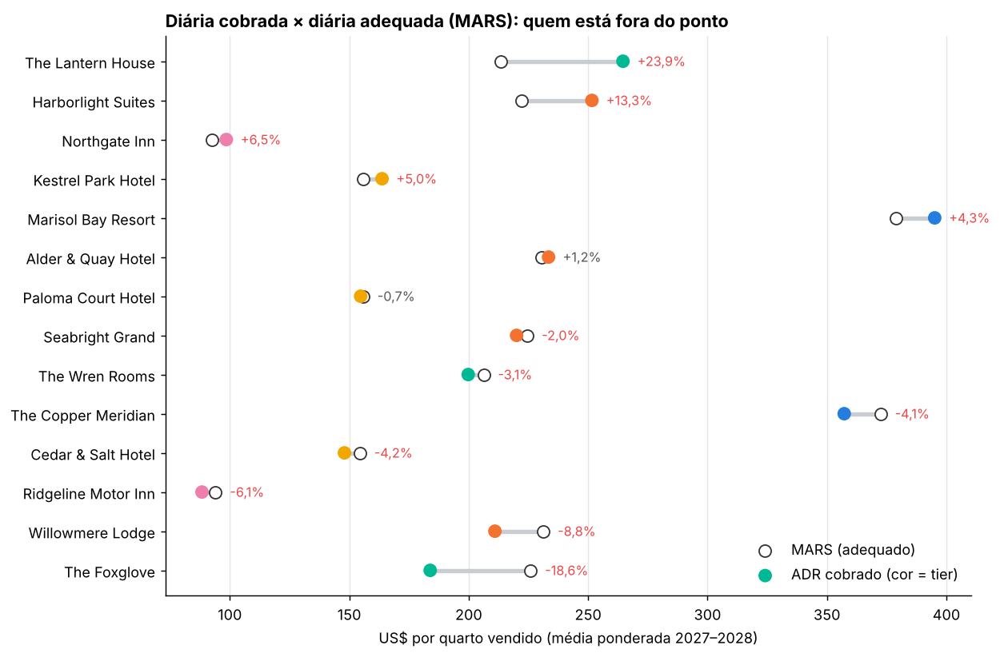
*ADR cobrado × MARS por hotel* (arquivo `graficos/G07_adr_x_mars.png`)

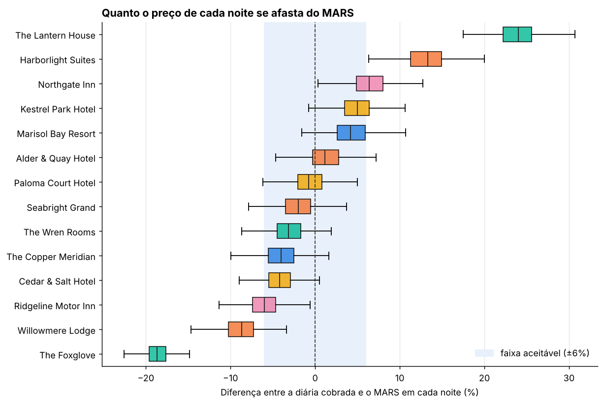
*Distribuição do desvio de preço em relação ao MARS* (arquivo `graficos/G08_desvio_mars_por_hotel.png`)


### 4.2 Tabela de diária adequada por estação

| hotel | inverno | primavera | verão | outono |
|---|---|---|---|---|
| Alder & Quay Hotel | 189 | 218 | 271 | 216 |
| Cedar & Salt Hotel | 127 | 146 | 181 | 145 |
| Harborlight Suites | 182 | 210 | 261 | 208 |
| Kestrel Park Hotel | 128 | 148 | 183 | 147 |
| Marisol Bay Resort | 312 | 355 | 442 | 356 |
| Northgate Inn | 77 | 87 | 108 | 87 |
| Paloma Court Hotel | 128 | 147 | 183 | 145 |
| Ridgeline Motor Inn | 78 | 89 | 110 | 89 |
| Seabright Grand | 184 | 213 | 263 | 210 |
| The Copper Meridian | 307 | 348 | 435 | 349 |
| The Foxglove | 186 | 214 | 266 | 212 |
| The Lantern House | 175 | 202 | 253 | 201 |
| The Wren Rooms | 169 | 194 | 243 | 193 |
| Willowmere Lodge | 189 | 219 | 270 | 217 |

Mediana do MARS por estação: é a referência de preço que cada gerente pode usar como ponto de partida.


### 4.3 Regra de recomendação (subir, manter ou baixar)

A regra do README foi programada na função `regra_acao()` e aplicada às 10.192 noites.
Concordância com `rate_action` do dataset: **97,0%**. O README avisa que 3% dos rótulos foram trocados de propósito (ruído), então ~97% é o esperado.

| dataset | hold | lower | raise |
|---|---|---|---|
| hold | 4196 | 39 | 148 |
| lower | 118 | 1185 | 0 |
| raise | 0 | 0 | 4506 |


## 5. Desempenho de cada hotel contra os concorrentes

Fórmulas: ocupação = vendidos/disponíveis; ADR = receita de quartos/vendidos; RevPAR = receita de quartos/disponíveis; ARI = ADR/ADR dos concorrentes × 100; MPI = ocupação/ocupação dos concorrentes × 100; RGI = RevPAR/RevPAR dos concorrentes × 100 (≈ ARI × MPI / 100). Todas calculadas a partir de **somas** (média ponderada), não média de médias.

| hotel_name | tier | rec_total | ocupacao_% | adr | revpar | ARI | MPI | RGI |
|---|---|---|---|---|---|---|---|---|
| The Lantern House | boutique | 9.250.900,2 | 75,7 | 264,6 | 200,3 | 138,3 | 99,9 | 138,1 |
| Northgate Inn | economy | 6.193.154,9 | 63,5 | 98,5 | 62,6 | 111,5 | 105,3 | 117,4 |
| Harborlight Suites | upscale | 22.118.666,8 | 74,9 | 251,6 | 188,4 | 113,0 | 103,0 | 116,4 |
| Marisol Bay Resort | luxury | 52.501.969,1 | 72,8 | 395,1 | 287,5 | 110,6 | 101,2 | 111,9 |
| Kestrel Park Hotel | midscale | 16.538.005,1 | 68,7 | 163,7 | 112,5 | 108,3 | 100,9 | 109,3 |
| Alder & Quay Hotel | upscale | 24.777.321,7 | 73,8 | 233,4 | 172,2 | 102,6 | 101,1 | 103,7 |
| Paloma Court Hotel | midscale | 11.599.161,8 | 68,6 | 154,8 | 106,2 | 98,9 | 100,6 | 99,5 |
| Seabright Grand | upscale | 32.359.440,4 | 72,8 | 220,0 | 160,3 | 93,9 | 99,3 | 93,3 |
| Cedar & Salt Hotel | midscale | 12.562.408,8 | 67,6 | 148,0 | 100,1 | 92,6 | 98,5 | 91,1 |
| The Copper Meridian | luxury | 21.282.979,8 | 71,9 | 357,2 | 256,8 | 90,4 | 98,8 | 89,3 |
| The Wren Rooms | boutique | 4.890.695,6 | 76,9 | 199,8 | 153,6 | 87,4 | 102,1 | 89,2 |
| Willowmere Lodge | upscale | 13.066.868,1 | 70,7 | 211,0 | 149,1 | 90,8 | 96,0 | 87,1 |
| Ridgeline Motor Inn | economy | 3.755.208,4 | 60,4 | 88,3 | 53,3 | 89,7 | 95,0 | 85,2 |
| The Foxglove | boutique | 5.105.581,2 | 74,8 | 183,9 | 137,6 | 77,4 | 98,2 | 76,0 |

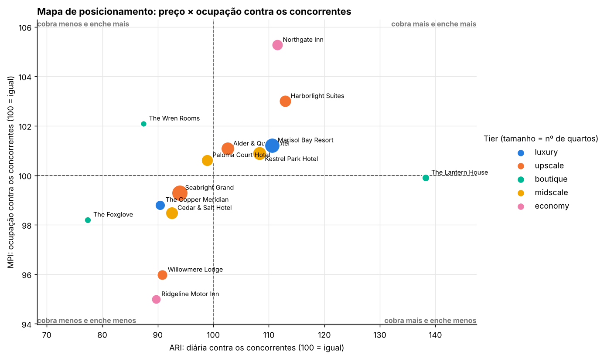
*Quadrantes ARI × MPI* (arquivo `graficos/G09_quadrante_ari_mpi.png`)


### 5.1 Sazonalidade e eventos

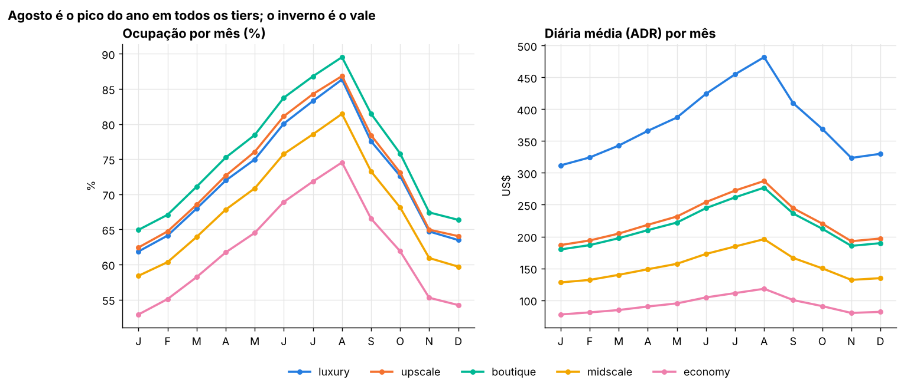
*Sazonalidade de ocupação e ADR por tier* (arquivo `graficos/G10_sazonalidade.png`)

Noites com evento de demanda × noites comuns:

| tier | ocupacao_comum | ocupacao_evento | adr_comum | adr_evento | ganho_ocup_pontos | ganho_adr_pct |
|---|---|---|---|---|---|---|
| luxury | 71,8 | 82,1 | 377,7 | 455,7 | 10,2 | 20,7 |
| upscale | 72,5 | 82,6 | 225,7 | 272,1 | 10,0 | 20,6 |
| boutique | 75,1 | 84,8 | 217,3 | 260,1 | 9,7 | 19,7 |
| midscale | 67,7 | 77,8 | 153,6 | 186,1 | 10,1 | 21,1 |
| economy | 61,6 | 70,9 | 93,0 | 112,3 | 9,3 | 20,8 |


## 6. As decisões de preço semanais funcionaram?

| acao | melhor_% | estavel_% | pior_% | semanas | mediana_variacao_revpar_% |
|---|---|---|---|---|---|
| raise | 38,3 | 30,8 | 30,9 | 634 | 0,4 |
| hold | 37,6 | 31,8 | 30,5 | 619 | 0,3 |
| lower | 42,9 | 26,5 | 30,7 | 189 | 0,7 |

Cálculo: `pd.crosstab(acao, resultado, normalize='index')` = % de cada resultado dentro de cada ação. Resultado = RevPAR da semana seguinte comparado à semana da decisão, com faixa de ±1,5%.

Leitura: nenhuma ação garante resultado; as três têm perfil parecido. Como não existe o "e se não tivesse mudado" (contrafactual), isso **não prova** que a decisão causou o resultado. A sazonalidade da semana seguinte pesa mais que a decisão.

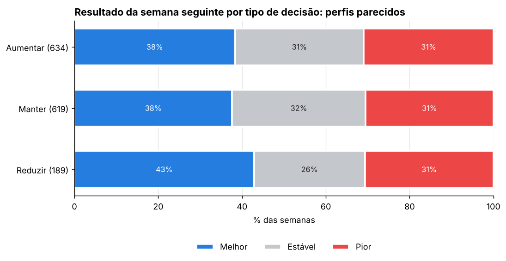
*Resultado das decisões de preço* (arquivo `graficos/G11_decisoes_preco.png`)


## 7. O que os hóspedes estão dizendo

| nota | freq_absoluta | freq_relativa_% | freq_acumulada_% |
|---|---|---|---|
| 1 | 1087 | 9,0 | 9,0 |
| 2 | 2439 | 20,2 | 29,2 |
| 3 | 3212 | 26,6 | 55,8 |
| 4 | 2302 | 19,1 | 74,9 |
| 5 | 3037 | 25,1 | 100,0 |

Avaliações com 3 estrelas ou menos: **55,8%**. Média = 3,31, mediana = 3, moda = 3.

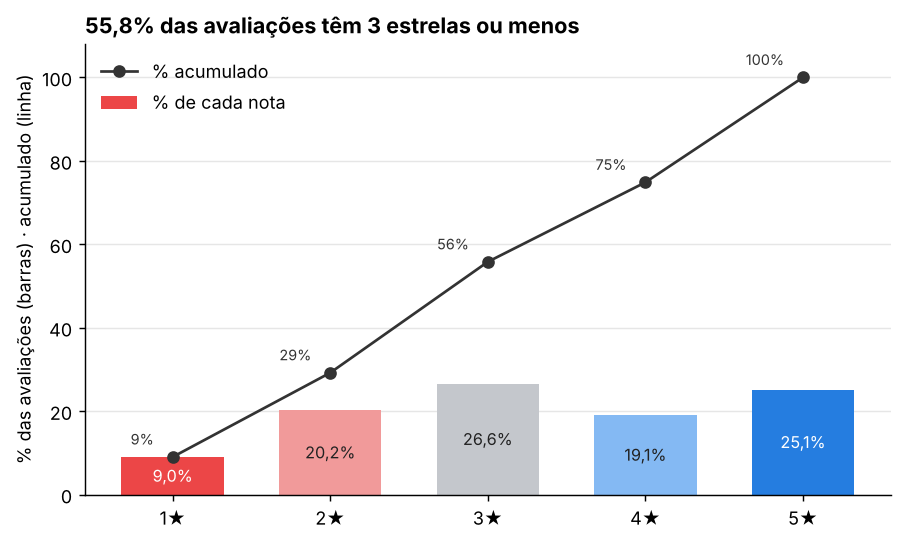
*Distribuição de frequências das notas* (arquivo `graficos/G12_distribuicao_notas.png`)


### 7.1 Cenários: por que os hóspedes avaliam assim

| label | avaliacoes | nota_media | respondidas_pct | recovery_action |
|---|---|---|---|---|
| Superou expectativas | 1840 | 4,84 | 29,46 | thank the guest and record the staff member |
| Estado do quarto | 1401 | 2,48 | 100,00 | block the room and raise a work order |
| Barulho e sono | 1250 | 2,42 | 100,00 | offer a move and a sleep kit, note the room |
| Localização e acesso | 1219 | 4,58 | 30,27 | none needed |
| Problema resolvido bem | 1206 | 4,33 | 34,99 | log the recovery and brief the shift |
| Cobrança e tarifas | 1027 | 1,63 | 100,00 | audit the folio and refund where due |
| Café da manhã e comida | 1023 | 3,73 | 55,13 | invite the guest back and review the buffet line |
| Fila no check-in | 1006 | 2,81 | 90,85 | add a queue check at peak arrival |
| Limpeza | 868 | 1,69 | 100,00 | reclean, inspect and coach the section |
| Wi-Fi e conexão | 765 | 2,74 | 92,94 | send the access point log to IT |
| Grupo ou família | 472 | 4,00 | 50,85 | confirm room allocations before arrival |

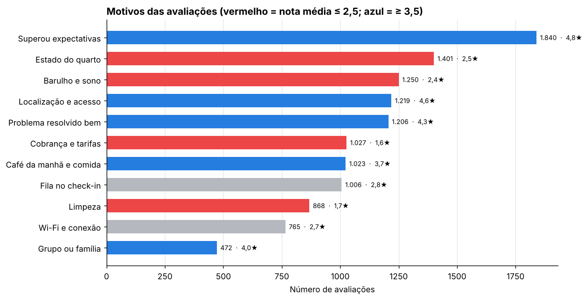
*Avaliações por cenário* (arquivo `graficos/G13_cenarios.png`)

Respostas do hotel por nota (taxa de resposta em % e tempo médio em horas):

| rating | taxa | horas |
|---|---|---|
| 1 | 100,0 | 21,2 |
| 2 | 100,0 | 21,2 |
| 3 | 100,0 | 21,1 |
| 4 | 28,8 | 20,2 |
| 5 | 29,9 | 21,4 |


## 8. Projeção simples de receita para 2029

Hotel: **Marisol Bay Resort**. Método: crescimento da receita **média por dia** de 2027 para 2028, aplicado mês a mês sobre 2028 (mantém a sazonalidade) e multiplicado pelos dias de cada mês de 2029.

- Cuidado encontrado: 2027 tem só 362 dias no dataset (começa em 04/01) e 2028 tem 366 (bissexto). Somar o ano inteiro daria um crescimento falso de 1,01%.
- Receita média por dia 2027: US$ 72.152 · 2028: US$ 72.085
- Crescimento = 72.085 / 72.152 − 1 = **-0,09%**
- Projeção 2029 = Σ (receita por dia do mês em 2028 × (1 + crescimento) × dias do mês) = **US$ 26.303.092**

**Limitações:** só 2 anos (um único ponto de crescimento); a extrapolação supõe que tudo continua igual (sem crise, sem novo concorrente, sem reforma, mesma agenda de eventos); o dataset é sintético.

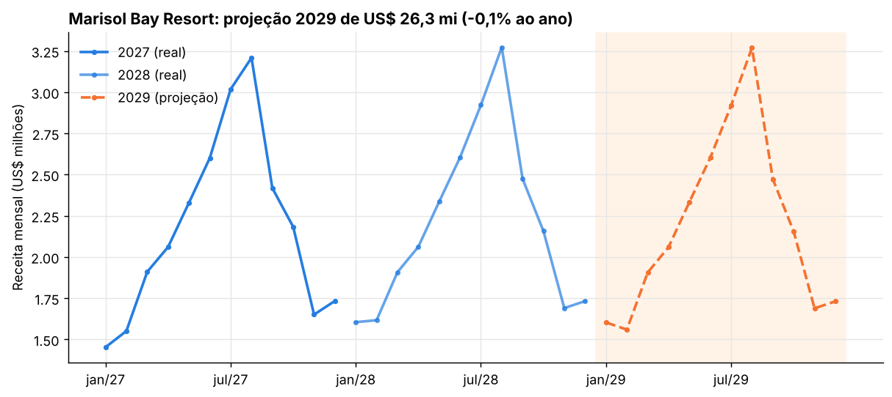
*Projeção de receita para 2029* (arquivo `graficos/G14_projecao_2029.png`)


## 9. Funções utilizadas

| biblioteca | função | para que foi usada |
|---|---|---|
| pandas | pd.read_json(..., lines=True) | ler arquivos JSONL (um registro por linha) |
| pandas | pd.to_datetime | converter texto em data |
| pandas | df.isna().sum() | contar valores ausentes por coluna |
| pandas | df.explode | transformar a lista de amenities em linhas |
| pandas | Series.value_counts | frequência absoluta |
| pandas | Series.cumsum | frequência acumulada |
| pandas | Series.isin | verificar integridade (registros órfãos) |
| pandas | df.merge | juntar tabelas (reviews + review_scenarios) |
| pandas | df.groupby(...).agg | somar/medianas por hotel, tier, mês, noite |
| pandas | Series.median | mediana do ADR dos concorrentes (MARS) |
| pandas | df.corr / Series.corr | correlação de Pearson |
| pandas | pd.crosstab | tabela cruzada ação × resultado |
| pandas | df.pivot / unstack | reorganizar de formato longo para largo |
| pandas | df.apply | aplicar a regra de ação linha a linha |
| pandas | df.to_csv | salvar as tabelas de resultado |
| matplotlib | plt.subplots | criar figura e eixos |
| matplotlib | ax.bar / ax.barh | barras (frequências, ranking, cenários) |
| matplotlib | ax.plot | linhas (sazonalidade, projeção) |
| matplotlib | ax.scatter | dispersão (correlação, quadrantes, validação) |
| matplotlib | ax.boxplot | distribuição do desvio de preço |
| matplotlib | ax.imshow | mapa de calor da matriz de correlação |
| matplotlib | ax.axhline / axvline / axvspan | linhas e faixas de referência (100, ±6%) |
| matplotlib | ax.annotate / ax.text | rótulos e setas |
| matplotlib | fig.savefig | salvar os gráficos em PNG |
| próprias | inspecionar_tabela() | resumo padronizado das 7 tabelas |
| próprias | verificar_relacao() | chave única, cardinalidade e órfãos de cada relação |
| próprias | calcular_mars() | recalcular a diária adequada de cada noite |
| próprias | regra_acao() | regra de subir/manter/baixar do README |
| próprias | registrar() / tabela_md() / salvar_grafico() | montar o relatório automaticamente |
